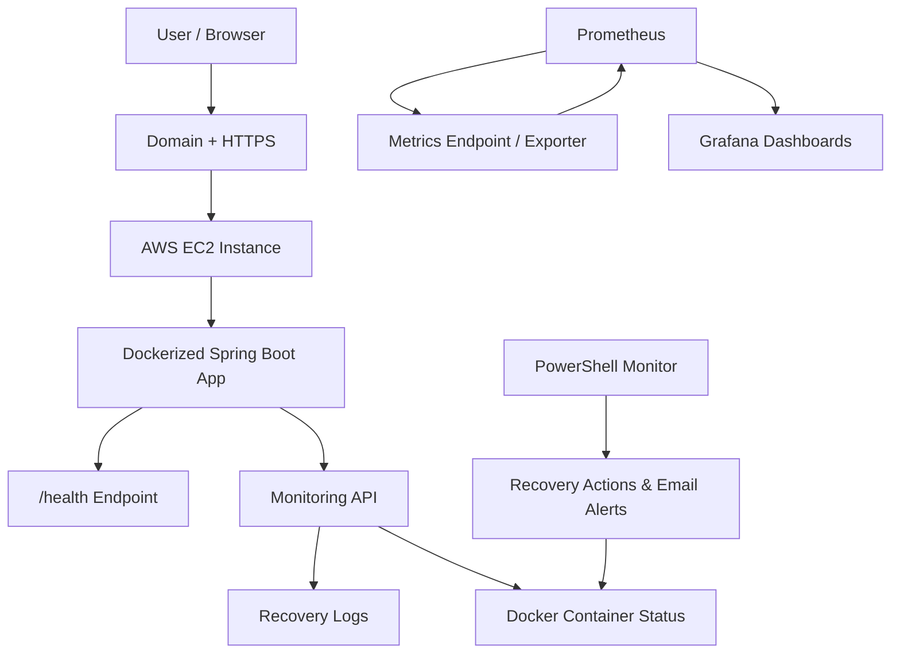

# 🚀 Auto-Healing Platform | Cloud Monitoring & Automated Recovery

<p align="center">
  <strong>A Docker-based self-healing application deployed on AWS EC2, with Spring Boot, Prometheus, Grafana, and automated recovery monitoring.</strong>
</p>

<p align="center">
  <a href="https://github.com/divyansh-cloudops/auto-healing-platform"></a>
  
  
  
  
</p>

## 📌 Project Overview

The **Auto-Healing Platform** is a cloud-hosted application monitoring and recovery project designed to demonstrate how container health checks, automated restart policies, monitoring dashboards, and recovery logs can improve application reliability.

Instead of relying only on manual checks, the project combines a Spring Boot application with Docker health monitoring and operational visibility through Prometheus and Grafana.

The platform is deployed on **AWS EC2** and includes a web-based monitoring dashboard, health endpoint, and recovery monitoring components.

🔗 **GitHub Repository:** https://github.com/divyansh-cloudops/auto-healing-platform

## 🎯 Problem Statement

Applications can become unhealthy or stop responding because of process failures, resource issues, or unexpected errors. Manual detection and recovery can increase downtime and require repeated operational effort.

This project explores a practical approach to:

- Check application health through an HTTP endpoint.
- Use Docker health checks to identify unhealthy containers.
- Configure container restart policies for recovery after eligible failures.
- Visualize infrastructure and application metrics.
- Record recovery events for troubleshooting and review.
- Deploy and operate the application on AWS EC2.

## ✨ Key Features

- **Application Health Check:** Spring Boot health endpoint at `/health`.
- **Container Health Monitoring:** Docker health checks for the application container.
- **Restart Policy:** Docker restart configuration to help recover from eligible container exits.
- **Monitoring Dashboard:** Web interface for container status, health, uptime, and recovery information.
- **Prometheus & Grafana:** Monitoring and visualization stack for operational metrics.
- **Recovery Logs:** Log-based tracking of recovery attempts and outcomes.
- **Email Alerts:** PowerShell monitoring script with email alert configuration.
- **Cloud Deployment:** Hosted on AWS EC2.
- **HTTPS Access:** Domain-based secure access configured for the deployed application.

> **Important:** Docker health checks report health status; they do not independently restart an unhealthy container. Actual recovery depends on the configured restart mechanism and monitoring/recovery logic.

## 🏗️ Architecture



*Architecture overview: application health, container operations, monitoring metrics, and recovery mechanisms work together to provide operational visibility.*

## 🧰 Technology Stack

| Category | Technology |
|---|---|
| Programming Language | Java 21 |
| Backend Framework | Spring Boot |
| Containerization | Docker |
| Cloud Platform | AWS EC2 |
| Monitoring | Prometheus |
| Visualization | Grafana |
| Automation | PowerShell |
| Health Monitoring | Spring Boot health endpoint and Docker health checks |
| Web Access | Nginx / HTTPS configuration |
| Version Control | Git and GitHub |

## 🖥️ Project Screenshots

Screenshots are stored in the repository's [`screenshots/`](https://github.com/divyansh-cloudops/auto-healing-platform/tree/main/screenshots) folder.

> Replace the example filenames below with the exact filenames in that folder. GitHub image paths are case-sensitive.

### 1. Application Dashboard


*Monitoring dashboard showing application status and operational information.*

### 2. Grafana Monitoring


*Grafana visualization for monitoring metrics.*

### 3. Prometheus Metrics


*Prometheus interface used to inspect monitoring data.*

### 4. Docker Container Health


*Container status and health-check information.*

### 5. Recovery Test


*Example recovery test showing container behavior during a failure scenario.*

### 6. AWS Deployment


*EC2 deployment and cloud-hosted application.*

## 🔍 Health Check

The application exposes a health endpoint:

```http
GET /health
```

Example successful response:

```json
{
  "status": "UP",
  "application": "auto-healing-platform",
  "timestamp": "2026-10-20T04:48:58.263480814Z"
}
```

Example local test:

```powershell
Invoke-RestMethod http://localhost:8080/health
```

A successful response indicates that the application health endpoint is responding.

## 📊 Monitoring API

The monitoring controller provides endpoints intended to expose container status, health, uptime, and recovery-log information.

| Endpoint | Purpose |
|---|---|
| `/api/monitoring` | Container status, health, uptime, and recovery summary |
| `/api/monitoring/history` | Recovery-log history |
| `/health` | Application health response |

Example:

```powershell
Invoke-RestMethod http://localhost:8080/api/monitoring
```

**Note:** Monitoring API availability depends on the version of the application currently deployed and the Docker socket/log mounts configured for monitoring. Verify these endpoints in your running environment before relying on the displayed recovery statistics.

## 🐳 Run Locally with Docker

### Prerequisites

- Git
- Docker Desktop or Docker Engine
- Java 21 and Maven Wrapper for building the application without Docker

### 1. Clone the repository

```bash
git clone https://github.com/divyansh-cloudops/auto-healing-platform.git
cd auto-healing-platform
```

### 2. Build the application

On Windows PowerShell:

```powershell
.\mvnw.cmd clean package -DskipTests
```

On Linux/macOS:

```bash
chmod +x mvnw
./mvnw clean package -DskipTests
```

### 3. Build the Docker image

```bash
docker build -t auto-healing-platform:local .
```

### 4. Run the container

```bash
docker run -d --name auto-healing-app --restart unless-stopped -p 8080:8080 auto-healing-platform:local
```

### 5. Check the application

Open:

- Health endpoint: http://localhost:8080/health
- Application dashboard: http://localhost:8080/

Check container status:

```bash
docker ps
```

View logs:

```bash
docker logs --tail 100 auto-healing-app
```

## 🔁 Understanding the Recovery Mechanism

The project demonstrates important building blocks of a recovery workflow:

1. **Detect:** Health checks and monitoring identify the current state of the application/container.
2. **Evaluate:** Monitoring or recovery logic determines whether an issue needs action.
3. **Recover:** A configured restart mechanism attempts to bring an eligible failed container back up.
4. **Record:** Recovery logs provide evidence for troubleshooting and validation.
5. **Observe:** Prometheus and Grafana provide monitoring visibility where metrics are correctly configured.

### Test container recovery

For a local test, stop the demo container:

```bash
docker stop auto-healing-app
```

Start it again:

```bash
docker start auto-healing-app
```

Inspect health and restart information:

```bash
docker inspect --format='Status={{.State.Status}} | Health={{.State.Health.Status}} | Restarts={{.RestartCount}}' auto-healing-app
```

> A manual `docker stop` is intentionally respected by the `unless-stopped` restart policy. To validate automatic recovery, test an eligible process/container failure in a controlled environment and confirm the restart count and logs afterward.

## 📈 Prometheus & Grafana

Prometheus and Grafana are included to demonstrate observability.

- **Prometheus:** Collects configured metrics from available scrape targets.
- **Grafana:** Visualizes metrics through dashboards and panels.
- **Resource monitoring:** CPU and memory panels require the appropriate exporter or metric source and valid Prometheus queries.
- **Troubleshooting:** If a panel displays “No data,” verify the Prometheus target, metric names, scrape configuration, and selected time range.

Monitoring dashboards should only be considered validated when they display real data from the configured targets.

## ☁️ AWS Deployment

The application has been deployed to an AWS EC2 instance.

Deployment components include:

- EC2 instance running the application infrastructure.
- Docker container for the Spring Boot application.
- Security-group rules for required access.
- Domain and HTTPS configuration.
- Prometheus and Grafana monitoring components.

For a safer deployment, expose only the ports required by your architecture. Avoid opening all inbound traffic to `0.0.0.0/0`; restrict SSH to a trusted IP and use appropriate access controls for monitoring services.

## 🔐 Security Considerations

- Never commit AWS credentials, private keys, Gmail app passwords, or tokens.
- Store secrets in environment variables or a suitable secrets manager.
- Do not expose the Docker socket or Docker management API to untrusted users.
- Restrict inbound security-group rules to required ports and trusted sources.
- Keep the operating system, Java runtime, and container images updated.
- Verify HTTPS certificate renewal and domain configuration periodically.

## 🧪 Validation Checklist

- [x] Spring Boot application builds successfully with Maven Wrapper.
- [x] Health endpoint responds successfully in the tested environment.
- [x] Docker image builds successfully.
- [x] Application container runs with a Docker health check.
- [x] Local container recovery behavior has been tested.
- [x] AWS EC2 deployment and HTTPS access have been configured.
- [ ] Verify the monitoring API against the latest deployed image.
- [ ] Verify Prometheus targets and confirm CPU/memory panels display data.
- [ ] Verify recovery logs and email alerts with a controlled test.
- [ ] Add verified screenshots to the README.

## 🚀 Future Improvements

- Add automated integration tests for recovery scenarios.
- Improve structured recovery-event logging and history.
- Add actionable Prometheus alert rules and Grafana alerts.
- Add CI/CD automation using GitHub Actions.
- Add deployment health checks and rollback procedures.
- Improve security hardening and secrets management.
- Document measured recovery time and failure-test results.

## 📚 What I Learned

Through this project, I explored:

- Building and packaging a Spring Boot application.
- Creating and running Docker images and containers.
- Understanding health checks and container restart policies.
- Deploying an application on AWS EC2.
- Configuring monitoring with Prometheus and Grafana.
- Troubleshooting API, container, and monitoring issues.
- Testing recovery behavior and interpreting operational logs.

## 👨‍💻 Author

**Divyansh Saini**

GitHub: [@divyansh-cloudops](https://github.com/divyansh-cloudops)

Project: [Auto-Healing Platform](https://github.com/divyansh-cloudops/auto-healing-platform)

---

⭐ If you find this project useful, consider starring the repository.

*Built as a hands-on DevOps and cloud-monitoring project to explore application reliability, observability, and container recovery.*
