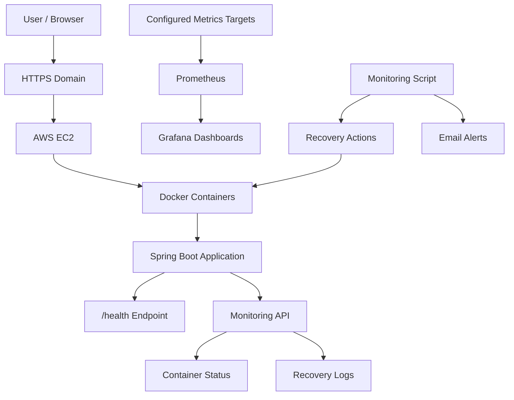

# 🚀 Auto-Healing Platform | AWS, Docker, Prometheus & Grafana

<p align="center">
  <strong>A cloud-deployed application monitoring and auto-recovery project built to explore reliability, observability, and DevOps automation.</strong>
</p>

<p align="center">
  <a href="https://autohealing-platform.duckdns.org">
    
  </a>
  <a href="https://github.com/divyansh-cloudops/auto-healing-platform">
    
  </a>
</p>

<p align="center">
  
  
  
  
  
  
</p>

## 🌐 Live Demo

**Live Website:** https://autohealing-platform.duckdns.org

**GitHub Repository:** https://github.com/divyansh-cloudops/auto-healing-platform

The project demonstrates a cloud-hosted Spring Boot application, Docker container health monitoring, recovery-related logging, and a monitoring stack using Prometheus and Grafana.

> Note: Website availability depends on the EC2 instance, DNS, HTTPS configuration, and running application services.

## 📌 Project Overview

The **Auto-Healing Platform** is a hands-on DevOps and cloud project focused on application health monitoring, container recovery, and operational visibility.

Applications may become unhealthy or stop unexpectedly. Detecting failures quickly and restoring services helps reduce downtime and manual intervention.

This project combines Docker health checks, container restart configuration, application health endpoints, recovery logs, and monitoring dashboards to demonstrate key concepts used in reliable cloud deployments.

## 🎯 Project Objectives

- Monitor application health using an HTTP endpoint.
- Run the application inside a Docker container.
- Configure container health checks and restart policies.
- Track recovery-related events using logs.
- Visualize configured metrics through Prometheus and Grafana.
- Deploy the application on AWS EC2.
- Provide HTTPS access through a configured domain.
- Explore automated monitoring and email alerting.

## ✨ Key Features

- **Spring Boot Application:** Java-based backend service.
- **Health Endpoint:** Application health check at `/health`.
- **Docker Health Checks:** Reports the health of the containerized application.
- **Container Restart Policy:** Helps restart containers after eligible failures.
- **Monitoring Dashboard:** Displays application and container information.
- **Prometheus:** Collects metrics from configured monitoring targets.
- **Grafana:** Visualizes metrics using dashboards and panels.
- **Recovery Logs:** Records recovery-related events for troubleshooting.
- **Email Alerts:** PowerShell monitoring script supports email notifications.
- **AWS EC2 Deployment:** Runs the application in a cloud environment.
- **HTTPS:** Secure web access through the configured domain.

## 🏗️ Architecture



## 🖼️ Project Screenshots

All 11 project screenshots are documented below. Select any image to open it in full size.

### 1. Grafana Monitoring Dashboard


*Grafana dashboard for visualizing configured monitoring metrics.*

### 2. Prometheus Target Status


*Prometheus target status and monitoring connectivity.*

### 3. Auto-Healing Recovery


*Recovery-related activity and application recovery information.*

### 4. Auto-Healing Application Dashboard


*Application dashboard for monitoring system status.*

### 5. Email Failure Alert


*Email notification generated for a failure event.*

### 6. Email Recovery Alert


*Email notification associated with recovery activity.*

### 7. AWS EC2 Docker Deployment


*Cloud deployment and Docker container operation on AWS EC2.*

### 8. Live HTTPS Dashboard


*Live dashboard accessed through the configured HTTPS domain.*

**Visit the live website:** https://autohealing-platform.duckdns.org

### 9. Auto-Healing Recovery Test


*Controlled recovery test to observe container behavior.*

### 10. Recovery Activity


*Recovery activity and related operational records.*

### 11. Recovery History


*Recovery history for reviewing recorded events.*

## 🧰 Technology Stack

| Technology | Purpose |
|---|---|
| Java 21 | Application runtime |
| Spring Boot | Backend application |
| Docker | Containerization |
| AWS EC2 | Cloud deployment |
| Prometheus | Metrics collection |
| Grafana | Monitoring dashboards |
| PowerShell | Monitoring and automation scripts |
| Git & GitHub | Source control and project hosting |
| HTTPS | Secure website access |

## 💚 Application Health Check

The application exposes the following health endpoint:

```http
GET /health
```

Example successful response:

```json
{
  "status": "UP",
  "application": "auto-healing-platform",
  "timestamp": "2026-10-20T04:48:58.263480814Z"
}
```

Test locally with PowerShell:

```powershell
Invoke-RestMethod http://localhost:8080/health
```

A successful HTTP response confirms that the health endpoint is responding.

## 📊 Monitoring API

The project includes monitoring endpoints intended to expose application/container status and recovery information.

| Endpoint | Purpose |
|---|---|
| `/health` | Application health response |
| `/api/monitoring` | Container status, health, uptime, and recovery summary |
| `/api/monitoring/history` | Recovery log history |

Example local request:

```powershell
Invoke-RestMethod http://localhost:8080/api/monitoring
```

The monitoring API requires the appropriate application version, Docker access, and recovery-log configuration. Verify the endpoints against the deployed version before relying on their statistics.

## 🐳 Run Locally with Docker

### Prerequisites

- Git
- Docker Desktop or Docker Engine
- Java 21 and Maven Wrapper if building the application locally

### 1. Clone the repository

```bash
git clone https://github.com/divyansh-cloudops/auto-healing-platform.git
cd auto-healing-platform
```

### 2. Build the application

Windows PowerShell:

```powershell
.\mvnw.cmd clean package -DskipTests
```

Linux/macOS:

```bash
chmod +x mvnw
./mvnw clean package -DskipTests
```

### 3. Build the Docker image

```bash
docker build -t auto-healing-platform:local .
```

### 4. Start the container

```bash
docker run -d --name auto-healing-app --restart unless-stopped -p 8080:8080 auto-healing-platform:local
```

### 5. Verify the application

Open these local URLs:

- Application: http://localhost:8080/
- Health check: http://localhost:8080/health

Check container status:

```bash
docker ps
```

View application logs:

```bash
docker logs --tail 100 auto-healing-app
```

## 🔁 Container Recovery Testing

Docker restart policies and health checks serve different purposes:

- A health check reports whether the application is healthy.
- A restart policy can restart a container after an eligible container exit.
- A health check alone does not automatically restart an unhealthy container.

For a basic manual stop/start test:

```bash
docker stop auto-healing-app
docker start auto-healing-app
```

Inspect container status and restart count:

```bash
docker inspect --format='Status={{.State.Status}} | Health={{.State.Health.Status}} | Restarts={{.RestartCount}}' auto-healing-app
```

A manual `docker stop` is intentionally respected by the `unless-stopped` restart policy. Test automatic recovery separately using a controlled failure scenario, then verify the container status, restart count, and recovery logs.

## 📈 Prometheus & Grafana

Prometheus and Grafana provide observability when the relevant metrics and scrape targets are configured correctly.

- **Prometheus:** Collects metrics from configured endpoints and exporters.
- **Grafana:** Displays metrics using dashboards and panels.
- **CPU and memory:** Require suitable metrics sources and valid Prometheus queries.
- **Troubleshooting:** Check target status, scrape configuration, metric names, and dashboard time range if a panel displays “No data.”

## ☁️ AWS Deployment

The project has been deployed to AWS EC2 with Docker-based application hosting and HTTPS access.

Deployment components include:

- AWS EC2 compute instance.
- Dockerized Spring Boot application.
- Configured network and security-group rules.
- Domain-based HTTPS access.
- Prometheus and Grafana monitoring components.

For security, expose only required ports, restrict SSH access to trusted IP addresses, and avoid exposing Docker management interfaces to untrusted users.

## 🔐 Security Best Practices

- Never commit AWS credentials, private keys, tokens, or Gmail app passwords.
- Use environment variables or a secrets manager for sensitive configuration.
- Restrict inbound traffic to required ports.
- Protect Docker socket access because it grants powerful control over the Docker host.
- Keep the operating system and container images updated.
- Check HTTPS certificate validity and renewal.
- Use appropriate access controls for monitoring dashboards.

## 🧪 Project Validation

- [x] Spring Boot application builds successfully.
- [x] Application health endpoint tested.
- [x] Docker image builds successfully.
- [x] Container health checks configured.
- [x] Local container recovery behavior tested.
- [x] AWS EC2 deployment configured.
- [x] HTTPS website configured.
- [x] Project screenshots collected.
- [ ] Confirm all monitoring panels show live metrics.
- [ ] Verify recovery logs and email notifications against the final deployment.

## 🚀 Future Improvements

- Add automated integration tests for recovery scenarios.
- Improve structured recovery-event logging.
- Configure Prometheus alert rules and Grafana alerts.
- Add CI/CD using GitHub Actions.
- Implement deployment rollback and improved failure handling.
- Improve monitoring API tests and error handling.
- Document measured recovery time and test results.

## 📚 Key Learnings

This project provided hands-on experience with:

- Spring Boot application development.
- Docker image creation and container operations.
- Application health checks and restart policies.
- AWS EC2 deployment and HTTPS configuration.
- Prometheus metrics and Grafana dashboards.
- Monitoring API troubleshooting.
- Recovery logging and email alert configuration.
- Cloud application reliability and observability.

## 👨‍💻 Author

**Divyansh Saini**

- GitHub: https://github.com/divyansh-cloudops
- Repository: https://github.com/divyansh-cloudops/auto-healing-platform
- Live Website: https://autohealing-platform.duckdns.org

---

⭐ If you find this project useful, consider giving the repository a star.

*Built as a hands-on DevOps project to explore cloud deployment, application monitoring, and container recovery.*
